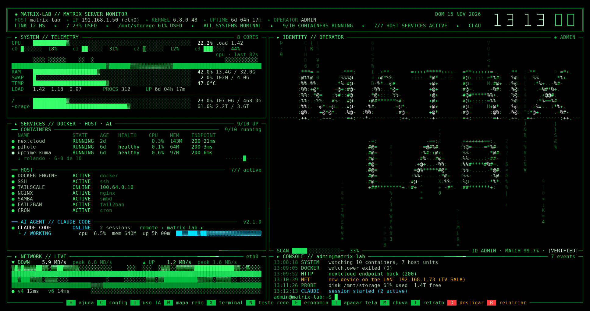
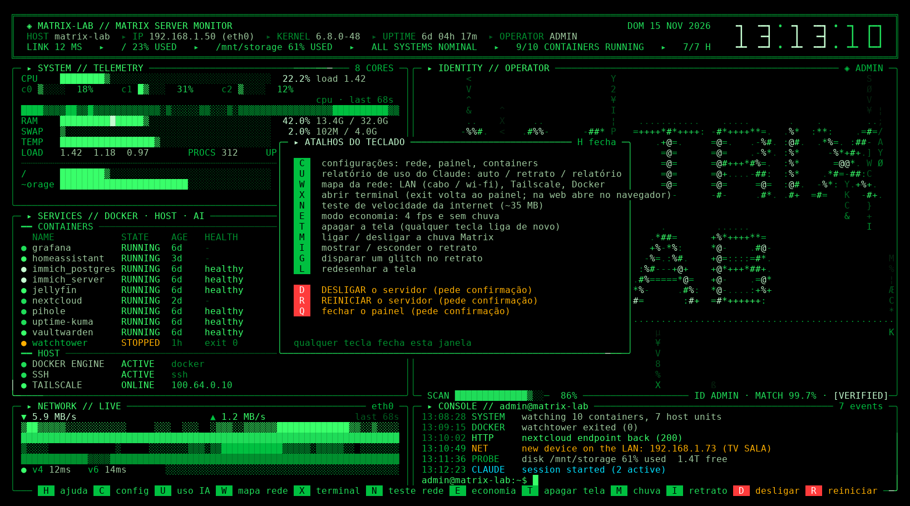
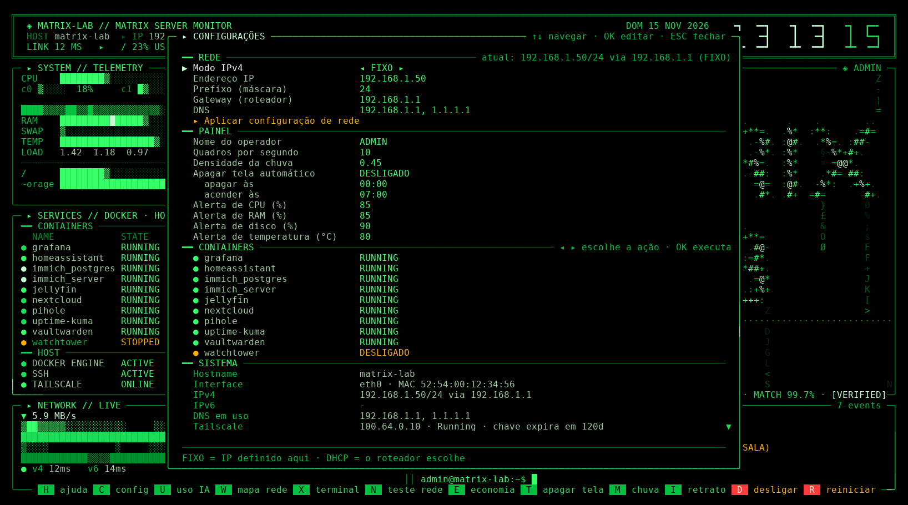

# Manual de uso

O painel se adapta ao tamanho do terminal:

| Tamanho | Layout |
|---|---|
| 140 colunas ou mais | completo, com o retrato à direita |
| 100–139 colunas | sem o retrato ([print](screenshots/medium.png)) |
| menos de 100×30 | compacto: sistema e containers ([print](screenshots/compact.png)) |

## Partes da tela

### Cabeçalho

- **Título**, data e relógio grande.
- **Linha de host**: nome, IP e interface, kernel, uptime e operador.
- **Ticker**: resumo rolando (containers rodando, serviços ativos, latência, uso dos discos). Fica
  **vermelho piscando** quando há alerta (CPU, RAM, disco ou temperatura acima do limite,
  container parado, internet fora).

### SYSTEM // TELEMETRY

- **CPU** total, cada núcleo e histórico dos últimos minutos.
- **RAM**, **swap**, **temperatura** (quando o hardware expõe sensores ao Linux), **carga**
  (1/5/15 min), número de processos e uptime.
- **Discos**: uso de cada disco detectado. A barra muda de cor ao passar do limite de alerta.

### SERVICES // DOCKER · HOST · AI

- **Containers**: todos, com estado, idade, health check, CPU, memória e o resultado do teste do
  endpoint (código HTTP e tempo, `tcp` ou `NO REPLY`). Os parados aparecem em âmbar. Quando não
  cabem todos, a lista rola sozinha (`↓ rolando · 6-8 de 10`).
- **Host**: serviços do systemd detectados (`ACTIVE`, `INACTIVE`, `FAILED`). O Tailscale mostra
  o IP e se está online.
- **AI agent // Claude Code** (só se instalado): online/offline, sessões, remote-control,
  trabalhando ou ocioso, CPU/memória e limites do plano.

### Retrato

Sua foto convertida em ASCII, ou o nome do servidor em letras grandes. Tem revelação em
"decode" na entrada, faixa de scan, brilho e glitch ocasional (`G` força um). Com o Claude Code
instalado, alterna a cada 40 s com um relatório de uso (`U` fixa um dos dois).

### NETWORK // LIVE

Download e upload em tempo real com pico, gráficos e latência IPv4/IPv6 até `ping_host`.

### CONSOLE

Eventos ao vivo com horário: container caiu/subiu/ficou unhealthy, serviço mudou de estado,
endpoint parou ou voltou, alertas, dispositivo entrou/saiu da rede, sessões do Claude e ações
feitas pelo teclado. Nos intervalos mostra uma sonda rotativa com um resumo do sistema.

## Teclas

| Tecla | Ação |
|---|---|
| `H` ou `?` | mostra/esconde os atalhos |
| `C` | menu de configurações |
| `W` | mapa da rede |
| `X` | terminal (no monitor: shell de login, `exit` volta; na web: shell no navegador, se ativado) |
| `N` | teste de velocidade da internet (baixa ~25 MB da Cloudflare) |
| `E` | modo economia: 4 quadros/s e sem chuva |
| `T` | apaga a tela; qualquer tecla acende |
| `M` | liga/desliga a chuva Matrix |
| `I` | mostra/esconde o retrato |
| `G` | glitch no retrato |
| `L` | redesenha a tela inteira |
| `U` | retrato / relatório de uso do Claude (só com Claude Code) |
| `D` | desliga o servidor (pede confirmação com `S`) |
| `R` | reinicia o servidor (pede confirmação com `S`) |
| `Q` | fecha o painel (pede confirmação com `S`) |

A barra de teclas no rodapé mostra só as teclas cujo recurso existe no servidor. `D` e `R`
precisam do `install_hotkeys_sudo.sh`.

## Menu de configurações (`C`)

Use as setas para navegar, `Enter` (OK) para editar ou executar, `←`/`→` para trocar opções e
`Esc` para fechar. As mudanças valem na hora e são salvas no `config.json`.

| Seção | O que dá para fazer |
|---|---|
| **Rede** | ver IP, prefixo, gateway e DNS atuais; com o helper instalado, trocar entre IP fixo e DHCP. Aplicar pede confirmação e, se o roteador não responder em 30 s, a configuração anterior volta sozinha |
| **Painel** | nome do operador, quadros por segundo, densidade da chuva, apagar a tela num horário, limites de alerta de CPU, RAM, disco e temperatura |
| **Containers** | iniciar, parar ou reiniciar qualquer container |
| **Sistema** | hostname, interface, MAC, IPv4/IPv6, DNS em uso, Tailscale e validade da chave |

## Mapa da rede (`W`)

Troca o corpo do painel pelo mapa da rede; `W` de novo volta.

- **LAN**: varredura a cada 60 s **sem root** (tabela ARP + ping IPv6 all-nodes). Mostra IP,
  nome (mDNS, NetBIOS ou DNS reverso), fabricante pelo MAC, ping e visto por último. Avisa no
  console quando um dispositivo entra ou sai.
- **Tailscale**: peers, sistema e se estão online.
- **Docker**: redes e os containers de cada uma.
- **Tráfego** por dispositivo/serviço quando dá para medir a partir do servidor.

O servidor não sabe se um aparelho está no cabo ou no Wi-Fi: `WI-FI~` é uma estimativa (MAC
privado). Para fixar nome e tipo use `devices` no `config.json`
(veja [Configuração](CONFIGURACAO.md#mapa-da-rede)). O histórico fica em `.netmap.json`.

## Espelho web

Com `web.enabled`, abra `http://<ip-do-servidor>:8095` de um computador ou celular da rede local
ou do Tailscale. A página mostra o painel ao vivo (só as células que mudam trafegam) e se ajusta
à janela.

| Opção | Efeito na página |
|---|---|
| padrão | só visualização |
| `web.control: true` | teclado do computador, clique nas teclas do rodapé e botões na parte de baixo (celular); `D`, `R` e `Q` continuam pedindo confirmação |
| `web.terminal: true` (exige `control`) | botão "X terminal": shell no navegador com o usuário do painel, **sem senha**. Fechar a aba encerra o shell; no máximo 4 ao mesmo tempo |

A página recusa quem não estiver nas redes de `web.allow` (padrão: localhost, Tailscale e as
redes locais do servidor).

## Terminal local (`X`)

No monitor do servidor, `X` troca o painel por um shell de login no tty1; `exit` ou `Ctrl+D`
volta. Pelo SSH a tecla avisa que não há console local.

## Apagar a tela automaticamente

No menu `C` → Painel → "Apagar tela automático", defina o horário (ex.: 00:00 às 07:00).
Qualquer tecla acende por 5 minutos. Quem está vendo pela web continua vendo o painel.
